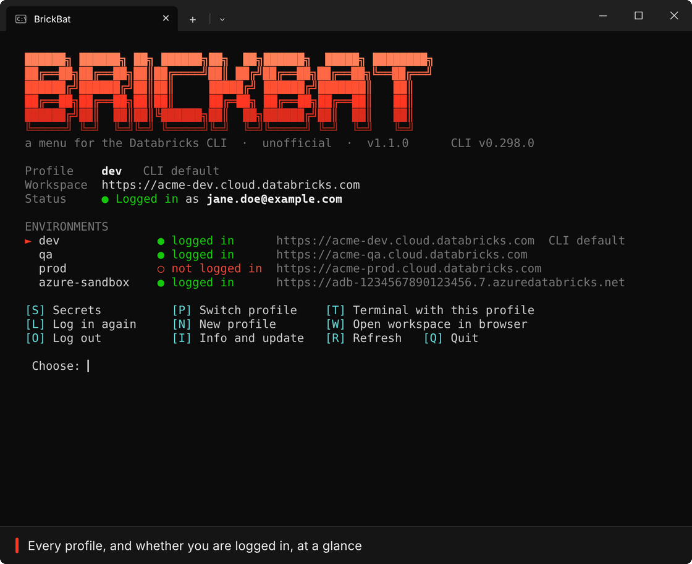

# BrickBat

A menu for the Databricks CLI in the Windows terminal.

## Features

- Login status of every profile at a glance
- Log in through the browser, log out, switch or add a profile
- A terminal where every `databricks` command uses the profile you picked
- Browse, search, create and delete secret scopes
- Add, update and delete secrets, without ever showing their values
- Grant, change and remove access to a scope
- Update one key or one person's access in several scopes at once, like dev, qa and prod
- Favourite scopes, a key press away
- Compare one scope across dev, qa and prod
- Works with AWS, Azure and Google Cloud workspaces

## Get started

Download [`brickbat.bat`](brickbat.bat) and double-click it. It runs on Windows 10 or 11 from any folder, and offers to install the Databricks CLI if you don't have it.

Screenshots and details are in the [guide](docs/GUIDE.md).

---

Unofficial, and not affiliated with Databricks, Inc. MIT [license](LICENSE).
