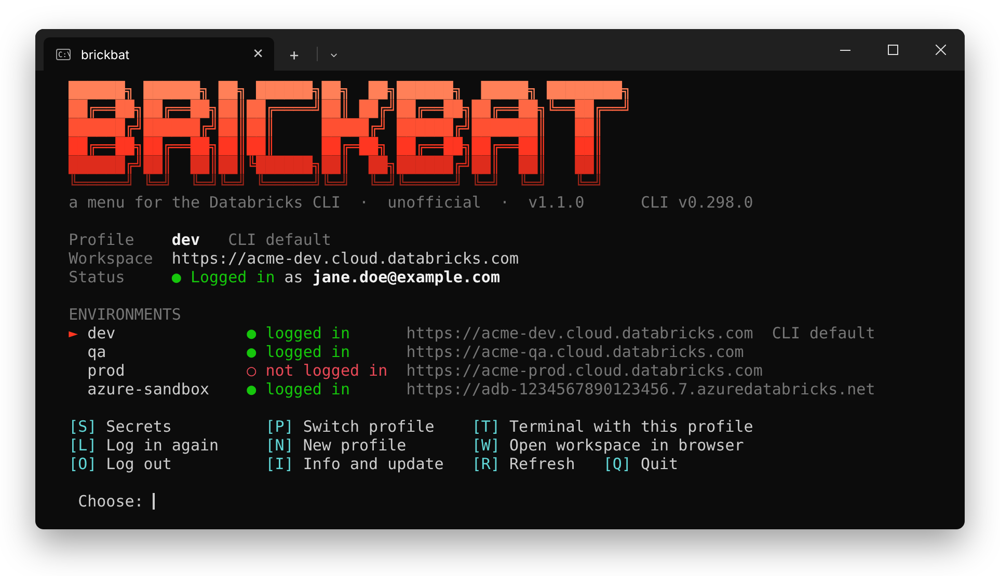
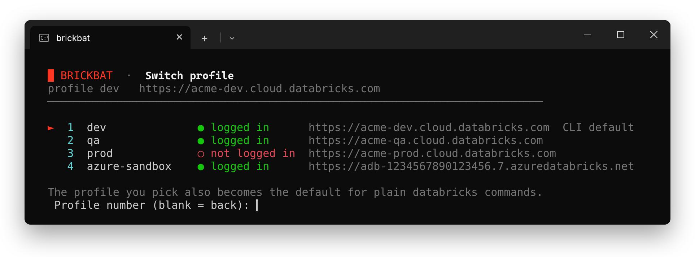
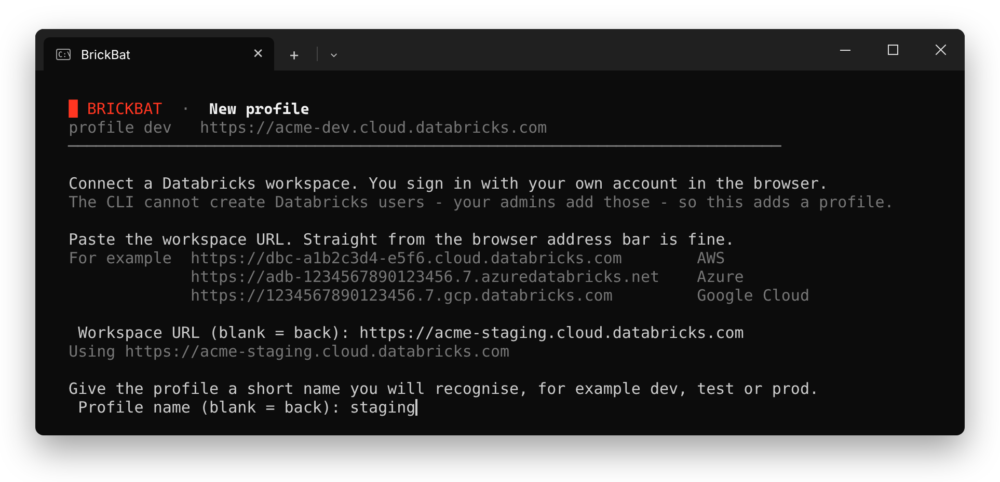
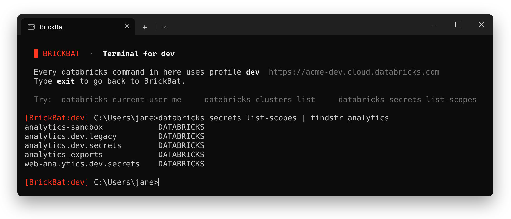
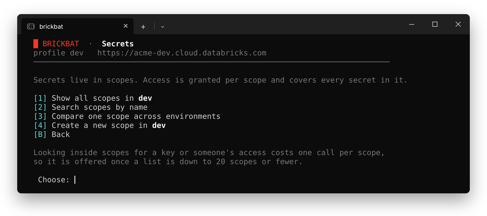
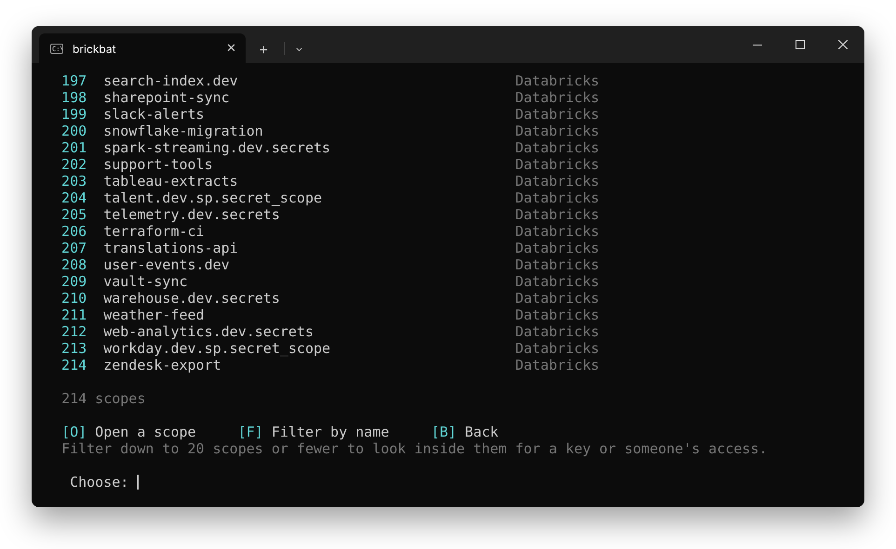
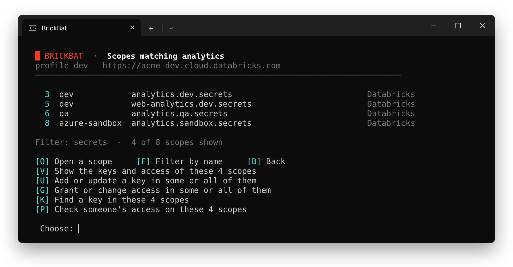
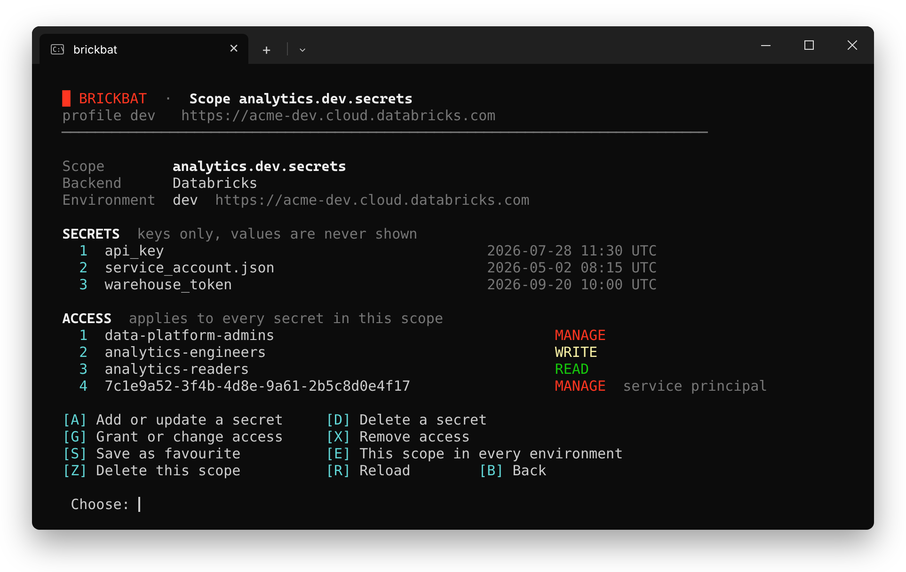
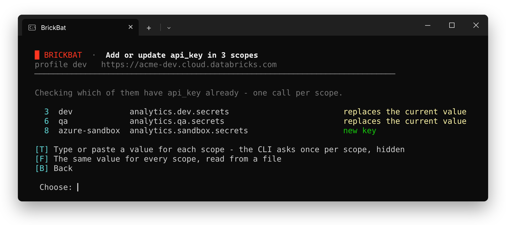
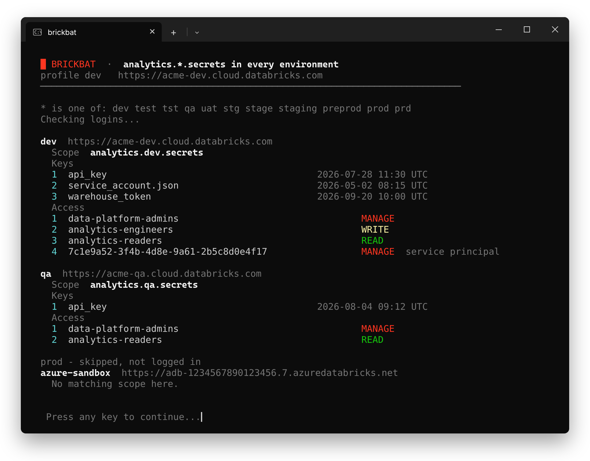

# BrickBat guide

## Profiles

The front page shows the active profile and every profile in your `.databrickscfg`, each with whether you're logged in.

**P** switches profile. By default, the one you pick also becomes the default for plain `databricks` commands.

**N** adds a profile: paste the workspace URL, give it a short name, and sign in in the browser.

**T** opens a terminal where every `databricks` command uses the active profile. Type `exit` to go back.

## Secrets

**S** on the front page opens Secrets. Show every scope in the workspace, search scope names in this workspace or every one you're logged in to, compare a scope across environments, create a scope, or open a favourite.

Filter a list of scopes by name, and open one by its number.

When a list is down to 20 scopes or fewer, you can look inside them: **V** shows the keys and access of all of them on one screen, **K** finds a key, and **P** checks someone's access. Search every environment you're logged in to and filter, and the list holds the same scope from each environment.

A scope shows its keys and who has access. Add, update or delete secrets, grant, change or remove access, or delete the scope. Secret values are never shown. For a multi-line value, like a JSON key, read it from a file.

## Several scopes at once

From a list of 20 scopes or fewer, **U** adds or updates one key in the scopes you pick, and **G** gives one user, group or service principal the same access in them. Pick them by their numbers in the list, or **A** for all. BrickBat first shows what changes in each scope, and changes nothing until you confirm.

When you type the value, the CLI asks once per scope, with the environment named above its prompt, so each environment can get its own value. To give every scope the same value, read it from a file.

## Favourites

Press **S** on a scope to save it as a favourite, and **S** again to remove it. Favourites are listed in the Secrets menu of their workspace, and **F** opens one.

They're kept on your PC in `%LOCALAPPDATA%\brickbat\favourites.txt`, one scope per line.

## Comparing a scope across environments

Press **3** in the Secrets menu, or **E** on a scope. When the scope name contains an environment word, like the `dev` in `analytics.dev.secrets`, BrickBat swaps it for each of the others and shows the keys and access it finds in every workspace you're logged in to.

The word can be set off by dots, underscores or dashes, so `ingest_dev` matches `ingest_prod` too.

## Settings

A few settings are at the top of `brickbat.bat`, each with a comment:

- `SYNC_CLI_DEFAULT=1` makes the profile you switch to the CLI default too. Set it to `0` to leave the CLI default alone.
- `LOOKUP_LIMIT=20` is how short a list must be before BrickBat offers to look inside its scopes. At most 50.
- `ENV_WORDS` lists the environment words used when comparing a scope.

Set the environment variable `NO_COLOR=1` to turn colours off.

## Good to know

- **Secret values** are never shown or kept by BrickBat. A typed value is hidden by the CLI, and BrickBat empties the clipboard after it is saved (clipboard history in Win+V keeps its own copy). A value from a file is sent exactly as saved, so BrickBat warns first if the file ends with a line break, starts with a byte-order mark or is UTF-16.
- **The profile decides the workspace.** `DATABRICKS_HOST`, `DATABRICKS_TOKEN` and similar variables set in Windows are ignored, so changes always go to the environment shown. A scope opened from another environment says so at the top.
- **Check someone's access** finds entries for that exact user, group or service principal, not access they get through a group.
- **Permissions:** seeing a scope's access needs MANAGE on it, and seeing its keys needs READ.
- **Token profiles:** Log in signs in with OAuth in the browser, so a profile that used a personal access token switches to OAuth.
- **Azure Key Vault-backed scopes:** add and delete their secrets in the Key Vault. You can still manage who has access here.
- **Files:** your last profile and your favourites are kept in `%LOCALAPPDATA%\brickbat`. CLI output (names, never secret values) goes to `%TEMP%` and is deleted when you quit with **Q**.
